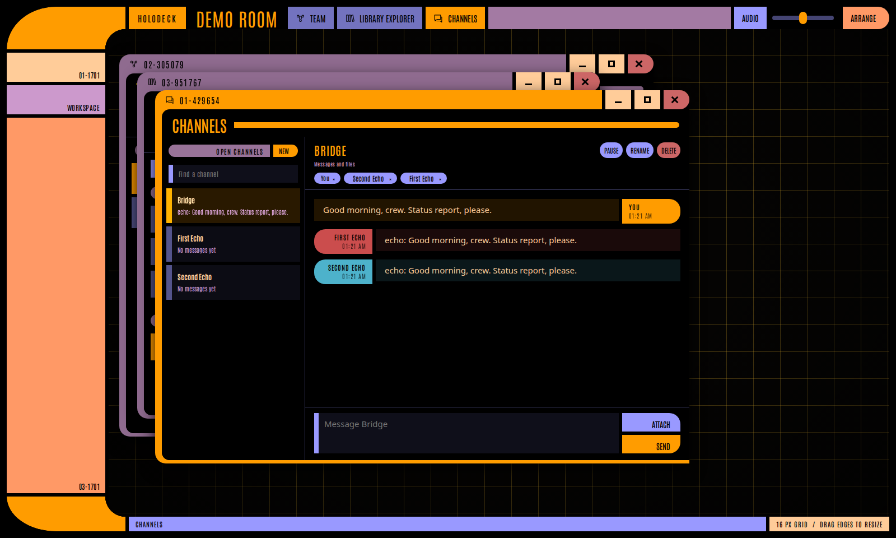
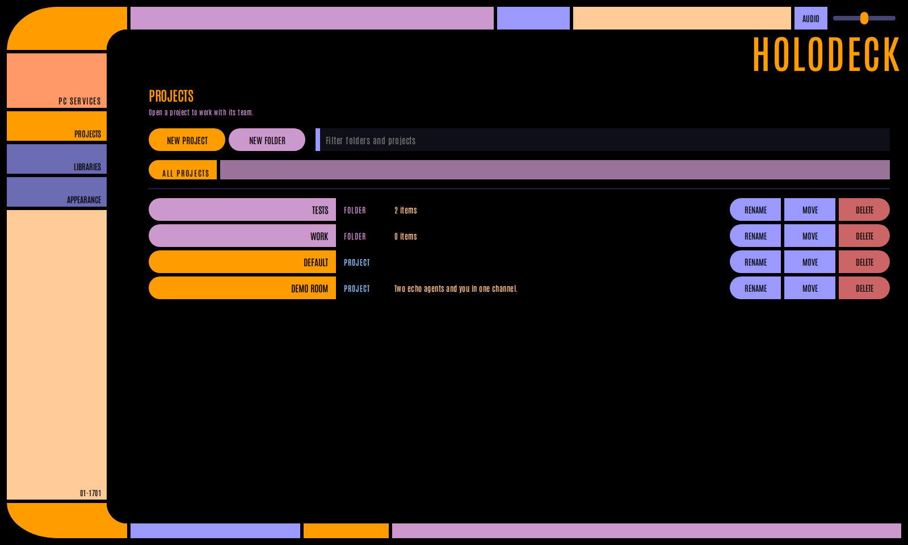
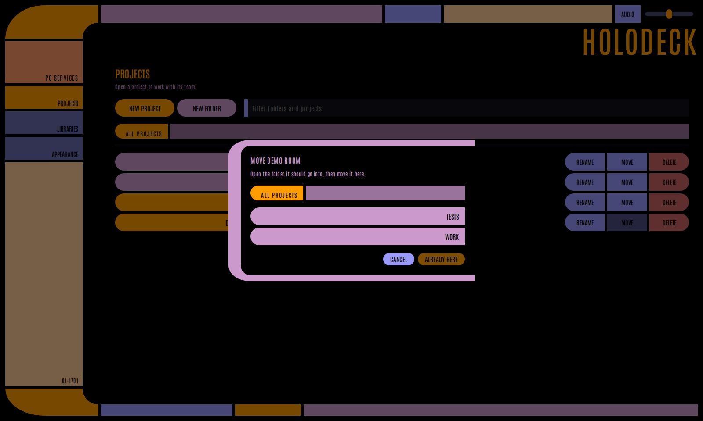
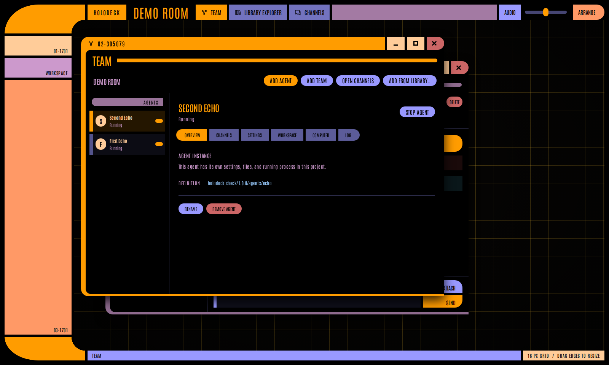
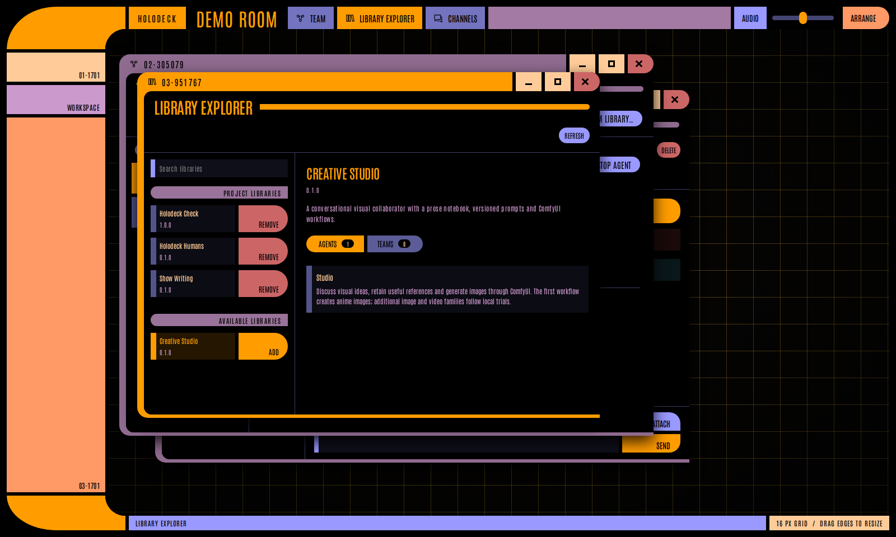

# Holodeck

**Agents in a room.** A project is a room where you and agents from local libraries talk in channels and hand each
other files. Every agent runs as its own user in its library's environment for the project; Holodeck runs it,
connects it to the room and stays out of what it is made of.



C# / ASP.NET Core backend, plain HTML/CSS/JavaScript frontend, PostgreSQL with pgvector, Docker for agents.
How it works: [ARCHITECTURE.md](ARCHITECTURE.md). Writing an agent: [agents/README.md](agents/README.md).
Current state: [WHEN_YOU_RETURN.md](WHEN_YOU_RETURN.md).

## A tour

### Projects

The main menu opens on the project explorer. Projects live in folders; the path band shows where you are, one
segment per level, and any segment takes you back up. Every folder and project can be renamed, moved or deleted.
Deleting a folder deletes everything inside it, except the Default project, which moves to the top level.



**Move** opens a small explorer: open the folder the item should go into, then move it there. A folder never
offers itself as a destination.



### Team

Inside a project the start menu has **Channels**, **Team**, **Library Explorer**, **Appearance** and **Main menu**,
and the project reopens with exactly the windows you left. Team places agents and library teams, starts and stops
them, and shows each agent's channels, settings, workspace, computer grants and log.



### Library Explorer

Agents come only from local libraries in `libs/`, as folders or ZIPs. Library Explorer shows the libraries attached
to the project, then the others available, each with its agents, teams and applets.



### Channels

A channel has any number of members, you included. Every member gets every post; agents decide whether to answer,
and **Pause** stops agents posting in a channel. Messages can carry files.

## Quick start

```bash
cp .env.example .env            # set a long random POSTGRES_PASSWORD
docker --context default compose up -d --build
```

Open **http://127.0.0.1:7077**, or **http://<PC address>/holodeck/** through the PC's front server
(`/Space/Servers/Front`), also from the LAN. The page boots into the main menu; create a project and open it.

To meet an agent: in Team choose **Add from library…**, add **Holodeck Humans** or **Show Writing**, then **Add agent**
and start it. These agents think through the GPU services of the `ai` stack in `/Space/Servers/AI`; start that stack
first. To try channels without a GPU, install the checks' echo library with
`node -e "require('./tests/fixture-library.cjs').install()"`, add **Holodeck Check** and place the **Echo Pair** team;
`remove()` takes it out again.

### On another machine

The stack itself needs only Docker. Two things normally come from the PC:

- **The LCARS library.** Holodeck loads it from the PC's front server and falls back to its own copy in
  `src/Holodeck.Web/wwwroot/lcars/` when that is unreachable, so the LCARS appearance works without Front.
- **The AI gateway.** Library agents carry the gateway address in their `settings.json`. Away from the PC, point them
  at another OpenAI-compatible endpoint or use agents that need no model.

On Windows, run Docker Desktop with WSL2 and keep the project inside the WSL filesystem. Linux is verified;
Windows/WSL has not been tested here.

## Libraries

A library is a folder or ZIP in `libs/` with a `Library.json`, `agents/` and `teams/`; see
[the library format](agents/README.md). Libraries may depend on exact versions of other local libraries, declare
the service processes their environment runs, and add applet windows. Removing a project's library reference stops affected programs and keeps
their instances, settings, files and history as unresolved until their original library comes back or the agent is
deleted.

[Holodeck Humans](libs/holodeck.humans/README.md) supplies the reusable **Person** agent.
[Show Writing](libs/holodeck.show-writing/README.md) depends on it and supplies the writing and bench roles.
Person source lives in `libs/holodeck.humans/HH-0.1.1/src/Humans/`; build and release it from that independent repository. See its [blueprint](libs/holodeck.humans/HH-0.1.1/BLUEPRINT.md).

Humans source projects are flat sibling checkouts of `git@github.com:HolodeckAI/holodeck.humans.git`:

```text
libs/holodeck.humans/
  HH-0.1.0/    retained baseline, complete source project
  HH-0.1.1/    development, complete source project
```

Both projects are recorded as source submodules in Holodeck. Initialize them with `git submodule update --init`, then work directly in the desired HH folder:

```bash
cd libs/holodeck.humans/HH-0.1.1
dotnet test Humans.slnx
bash publish.sh                 # builds this project only
```

Every project owns its source, tests, prompts and blueprint. There are no nested version projects. The outer library contains only integration metadata and the development Person assets that Show Writing launches. HH-0.1.1's shared database prompt implementation is preserved but deployment is paused.

## Library environments

Each project runs one persistent container per exact library version it references, from the trusted image
`holodeck-library:1` that Compose builds. Inside it a supervisor runs every declared service and every agent as its own
non-root user with a private home, table and credentials. Start and Stop control only that agent's process. Holodeck
shutdown leaves agents running; startup reconnects to them and leaves stopped agents stopped. A host or Docker engine
shutdown leaves agents stopped until explicitly started. Agents have open network access and reach the `ai` stack at the
address in their settings. Holodeck reaches Docker only through a socket proxy.

Team's **Computer** tab shows the library's services, requested ports and disk use. Port and folder grants
(`AGENT_FOLDER_ROOT` in `.env`) are not available yet: grant changes and replacing an existing agent's definition are
refused. An agent's table and home live in its environment under `data/rooms/`; **Reset environment** requires the
agent to be stopped and clears only its home and installed tools. Use the default Docker context only and never start
a second stack on the same `data/postgres`.

## Appearance

The LCARS appearance uses the reusable LCARS library for its frames, sound cues, saved audio preferences and its
Audio/Muted button and volume slider. The library mounts that control in fixed main-menu and workspace slots; only the
current screen's slot is shown, and no controls are floated or moved. Other appearances stay silent.

## MCP

`src/Holodeck.Mcp` is an MCP server over stdio that drives Holodeck through the same app API as the browser:
projects, libraries, agents, settings, grants, channels, messages and files, and management actions. Everything is
done as You. It calls the API at `Holodeck__Url` and adds no endpoint to the app, so it needs no rebuild of the stack.
Build it once with `dotnet build src/Holodeck.Mcp`; `.mcp.json` (Claude Code) and `.codex/config.toml` (Codex) start
the built DLL from the project directory. `wait_for_messages` waits for a reply after a message you sent; non-text and
large files are saved to a temporary folder and the tool answers with the path.

The app API has no authentication and is published on `127.0.0.1` only. Anything that can reach that port, including
this server, has full control of the stack.

## Development

```bash
# C# tests need a disposable database (once): CREATE DATABASE holodeck_test on the compose PostgreSQL, then
export HOLODECK_TEST_DATABASE="Host=127.0.0.1;Port=5433;Database=holodeck_test;Username=astudio;Password=...;GSS Encryption Mode=Disable"
dotnet test Holodeck.sln
dotnet test libs/holodeck.humans/HH-0.1.1/Humans.slnx  # independent Humans suite

# Against the running stack (Playwright from any local install):
PLAYWRIGHT_PACKAGE=/path/to/node_modules/playwright node tests/room-browser-check.cjs
PLAYWRIGHT_PACKAGE=/path/to/node_modules/playwright node tests/timeline-browser-check.cjs  # channel order across reloads, scrolling, new channels
node tests/computer-check.cjs            # what an agent can see and reach, persistence, reset, crash output
node tests/mcp-check.cjs                 # MCP server over stdio: places and talks to an echo, then deletes its project
```

```text
src/Holodeck.Mcp/    MCP server (stdio) over the app API
src/Holodeck.Web/
  HolodeckApp.cs     composition and startup
  Projects/          projects and folders
  Rooms/             library, members and channels, packets, the agent supervisor
  Computers/         library environments, agent runtime, grants, host paths, and isolation
  Endpoints/         project API, room API (+ live events), agent contract
  wwwroot/           main menu and desktop shell; channels, team, library explorer, appearance
  wwwroot/lcars/     fallback copy of the LCARS library
libs/                local library folders or ZIPs (Humans, Show Writing, Creative Studio)
tests/fixtures/      the checks' fixture library (echo agent, Echo Pair), copied into libs/ only while a check runs
agents/              the agent contract and library format (README.md)
runtime/library/     trusted environment image, supervisor and its isolation check
docs/screenshots/    the images in this README
tests/               C# tests, browser and live checks
```

C# conventions: [AGENTS.md](AGENTS.md).
