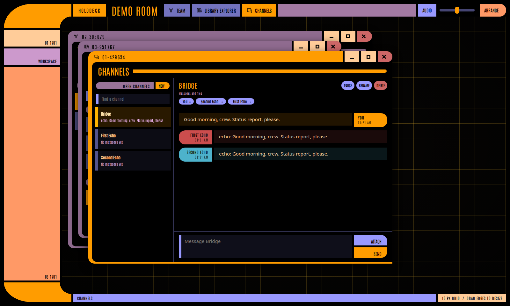
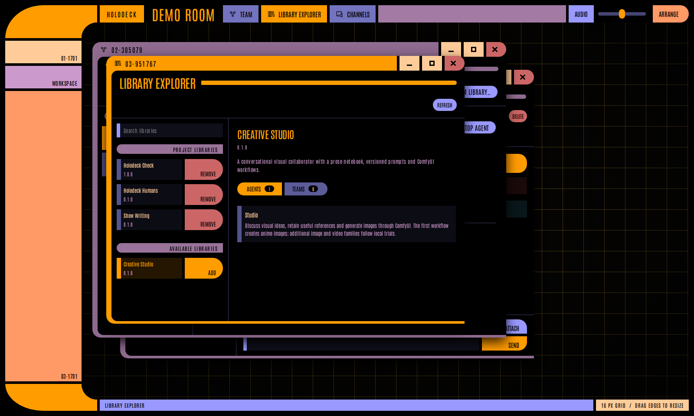

# Holodeck

Holodeck este o platformă personală în dezvoltare pentru colaborarea dintre oameni și agenți AI. Fiecare proiect oferă un spațiu comun în care utilizatorul și agenții pot comunica prin canale și pot schimba fișiere. Agenții și echipele provin din biblioteci reutilizabile, atașate proiectelor în funcție de nevoi.

Dezvolt platforma cu ajutorul agenților de programare AI. Lucrez astfel cu AI pentru a construi infrastructura în care pot funcționa alți agenți și echipe, apoi aplicații bazate pe această infrastructură.

## Ce face

- Organizează proiectele și bibliotecile de agenți, echipe și aplicații ale bibliotecilor.
- Permite adăugarea agenților și echipelor în proiecte și controlul pornirii și opririi agenților.
- Oferă canale cu mai mulți participanți, inclusiv utilizatori și agenți, cu mesaje și fișiere.
- Rulează fiecare versiune de bibliotecă într-un mediu Docker separat pentru fiecare proiect, cu utilizatori Linux separați pentru agenți și servicii.
- Păstrează configurațiile, fișierele și istoricul agenților și oferă instrumente de administrare a mediilor lor.
- Include un server MCP prin care clienții compatibili pot administra proiecte, biblioteci, agenți și canale.

Platforma gestionează comunicarea și execuția; implementarea și comportamentul agenților aparțin bibliotecilor. Această separare permite dezvoltarea unor tipuri diferite de agenți fără rescrierea platformei.

## Biblioteci și aplicații

Bibliotecile existente includ **Holodeck Humans**, pentru agentul Person, **Show Writing**, pentru roluri de scriere, **Creative Studio**, pentru un flux conversațional de generare de imagini, și **Holodeck Utilities**, cu o aplicație Bash. Aceste componente au niveluri diferite de maturitate și continuă să evolueze.

Un agent de programare și alte instrumente pentru probleme concrete din organizații sunt direcții de dezvoltare pe această infrastructură.

## Tehnologii

- **Backend:** C# și ASP.NET Core.
- **Interfață:** HTML, CSS și JavaScript, cu spațiu de lucru în ferestre și aspect LCARS.
- **Stocare:** PostgreSQL și pgvector.
- **Execuție:** Docker și procese Linux separate pentru agenți și servicii.
- **Integrare:** API-uri HTTP, MCP și, în bibliotecile relevante, servicii de modele AI și ComfyUI.

## Cod sursă și documentație

Acest director include codul sursă al platformei, bibliotecile și proiectele asociate, copiate din versiunea locală de lucru. Include și modificările locale care nu au fost încă înregistrate în Git în proiectul original.

| Componentă | Cod sursă |
| --- | --- |
| Soluția principală | [Holodeck.sln](Holodeck.sln) |
| Aplicația web și backendul | [src/Holodeck.Web](src/Holodeck.Web) |
| Serverul MCP | [src/Holodeck.Mcp](src/Holodeck.Mcp) |
| Agenți și contractul bibliotecilor | [agents](agents) |
| Bibliotecile de agenți și aplicații | [libs](libs) |
| Mediul de execuție al bibliotecilor | [runtime/library](runtime/library) |
| PiSharp | [pi-sharp](pi-sharp) |
| Testele platformei | [tests](tests) |

Consultă [documentația originală](README-original.md) pentru instalare și [arhitectura platformei](ARCHITECTURE.md) pentru organizarea componentelor. Versiunile Humans sunt incluse ca directoare cu surse, fără a necesita inițializarea submodulelor Git. Artefactele compilate ale agenților trebuie generate prin scripturile lor de publicare înainte de utilizare.

Copia nu include parole, configurații locale ale asistenților, baze de date, fișierele agenților din execuție sau rezultate de compilare. Fișierul [.env.example](.env.example) oferă configurația de pornire fără credențiale reale.

Dezvoltarea continuă în [depozitul Holodeck](https://github.com/HolodeckAI/Holodeck).

[Înapoi la portofoliu](../../README.md)
