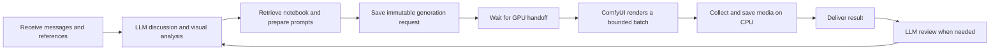

# Creative agent design

The creative agent is a conversational collaborator with a visual notebook and four generation families: realistic images, realistic video, anime images and anime video. It remembers references, develops a brief with the user, operates versioned ComfyUI workflows, and returns media to the conversation. The first implementation is the separate Creative Studio library with an Anima Turbo text-to-image workflow, notebook storage, selected reference inspection and prompt revision actions. The remaining workflow families and richer workspace are planned. The live conversation-to-render loop is verified, including notebook reuse and recovery across an agent restart during rendering. Direct image conditioning is not part of the first graph.

The application divides ownership explicitly. Holodeck provides communication, durable files, private PostgreSQL storage and generic controls. The creative library owns its conversation, notebook, prompts, workflow definitions and generation records. The standalone AI stack owns inference servers, model installation and GPU scheduling.

## What Holodeck already provides

| Capability | Available behavior | Use by this agent |
| --- | --- | --- |
| Agent lifetime | One persistent computer per agent (its user, home and table in the library environment); Start and Stop retain it | Keep the notebook and work across process restarts |
| Storage | A private PostgreSQL schema and role per agent, with pgvector | Ordinary tables, transactions, indexes and JSONB for application records; vector search for formed prose notes |
| Files | Persistent workspace and home; delivered attachments copied to the workspace | Keep original references, generated outputs, thumbnails and exports |
| Messages | Stable participant, packet and channel identities; original send timestamps | Associate references and decisions with their source conversation |
| Reliable delivery | Durable packet queues and idempotent outgoing sends | Save a receipt before acknowledging input; send each completed result once |
| Activities | Streamed and retained prose with application-authored phase labels | Show discussion, GPU waiting, loading, generation and delivery |
| Settings | Schema forms, validation and conditional updates | Connection configuration and selected working profiles |
| Management actions | Library declarations, forms, job claims, progress, cancellation and results | Explicit tuning, comparison and export operations |

The database is normal PostgreSQL with a vector extension. A library PostgreSQL service would duplicate infrastructure for this single-agent design. Each database call is its own transaction; generation never holds a database transaction or connection open while waiting for the GPU.

Database ownership is per agent instance. A second creative agent would have a separate notebook. Sharing between instances should be explicit; a shared library service becomes justified only if a shared notebook is actually required.

Holodeck does not currently provide agent access to arbitrary historical conversations or a searchable global media collection. The agent can index files it receives and files it creates. Older material from other conversations needs explicit import or permissioned sharing. Image delivery supplies file bytes, not visual understanding.

## User experience

The ordinary interaction stays conversational. The agent can discuss composition, lighting, character design, camera movement and tradeoffs without generating anything. A direct request to make an image authorizes that work; exploratory discussion does not automatically spend a render. This judgment belongs to the model, never keyword rules.

For example, the user shares a reference and calls her Princess Vespa. The agent can retain the original image, a grounded visual description and the user's notes. Later, “Put Vespa in a rain-soaked station, keep her face and costume” retrieves that entry, chooses the accepted reference and prepares the relevant workflow. “Animate this version” starts from the chosen result and its lineage.

The notebook distinguishes user-approved details from agent proposals and alternatives. An image can illustrate a costume without becoming the accepted face reference. The agent asks a focused question when several entries match and the distinction affects the output.

Holodeck's inbox retains messages until the agent chooses to consume them. The agent finishes its LLM phase, submits work to ComfyUI and waits before consuming more messages for model reasoning. New creative instructions can remain queued until the next conversation phase. A CPU worker can still collect results and maintain transport state. Richer progress presentation and gateway status UI are pinned for later. A model-operated cancellation tool is outside the initial tool set because the LLM is unavailable during rendering.

## GPU phases

All LLM work needed for a batch finishes before ComfyUI submission: reference inspection, intent interpretation, workflow selection, prompts, variation plans and any planned motion. ComfyUI receives a complete executable request. Its graph does not call another LLM to rewrite the prompt mid-render.

The agent's CPU controller follows execution and collects results without keeping the LLM loaded. Several planned variants can run together while their image model is resident. After rendering, outputs can be delivered immediately; an optional visual review happens after the gateway returns the GPU to the LLM. Review does not create an unbounded automatic rerender loop.

The existing gateway already queues inference requests, checks available memory, drains active holders and releases models. ComfyUI's busy check includes queued and running work, so prompt submission returning is not equivalent to the GPU becoming idle. Llama is released by stopping its service; ComfyUI releases its loaded models.

Use Holodeck's existing message queue and the gateway's existing GPU coordination. The agent chooses when to consume its inbox and avoids starting its own background LLM work during a ComfyUI phase. No additional GPU scheduler or phase-reservation API is planned for the initial increment. The gateway status API is available for a future status display; broader Holodeck presentation work is pinned.

The controller distinguishes waiting for GPU availability, loading a model and executing a workflow internally. It can follow these states without the LLM. A transport timeout does not by itself mean the render failed.

## Four workflow families

| Family | Core work | Reference support |
| --- | --- | --- |
| Realistic images | Generate, edit and make variations with natural materials, light and anatomy | Character, clothing, composition and style references |
| Realistic video | Animate an approved image or produce a planned shot | Starting image, supported ending frame, motion and camera brief |
| Anime images | Character sheets, scenes, expressions and controlled anime styles | Accepted character design, palette, outfit and pose references |
| Anime video | Animate anime artwork with stable design and deliberate motion | Approved anime still and supported shot controls |

These are user-facing capabilities. Each family can contain several versioned graph variants for generation, editing, reference conditioning or quality comparisons. Different models can back the same family. The agent sees each workflow's actual controls and capabilities; it cannot invent an unsupported reference mode, negative prompt, duration or resolution.

An authored workflow includes the editable ComfyUI graph, an exported execution graph, a manifest describing supported inputs and outputs, and mappings from named controls to graph inputs. Application code validates a focused tool request and fills those mapped inputs. The model writes prompts and chooses controls; it never authors arbitrary node graphs, filesystem paths or executable nodes.

Model-specific prompting belongs in versioned files. A workflow may prefer detailed prose, tags, reference markers or a separate motion description. The conversation remains natural regardless of those requirements.

## Model candidates

Selection follows local trials. Current candidates are alternatives, not installed defaults or claims of measured performance.

| Family | Candidates | Reason to test |
| --- | --- | --- |
| Realistic images | FLUX 3 Image Klein distilled; Qwen Image 2.1 | Current generation and editing models with reference-image support |
| Realistic video | LTX-2.5 distilled; LTX-2.3 as a fallback trial | Current video capability, with practical memory and runtime still decisive |
| Anime images | Anima Turbo and Anima Aesthetic | Dedicated anime generation with different speed and aesthetic choices |
| Anime video | AnimeGen I2V; LTX conditioned on an Anima result | Compare an anime-specialized model with a general video model using a strong reference |

[FLUX 3 Image Klein](https://bfl.ai/blog/flux-3-image-klein) provides generation, editing and multiple references; [ComfyUI's guide](https://docs.comfy.org/tutorials/flux/flux-3-klein) describes quantized workflows and an optional prompt upsampler. This design prepares its caption in the agent and omits that additional LLM stage. [Qwen Image 2.1](https://huggingface.co/Qwen/Qwen-Image-2.1) is a second generation/editing candidate with transparent-image support.

[Anima](https://huggingface.co/circlestone-labs/Anima) is dedicated to anime and illustration. [AnimeGen I2V](https://huggingface.co/aidealab/AnimeGen-I2V) is specialized for Japanese anime video, but its recommended hardware is substantially larger than the current card. [LTX-2.5](https://huggingface.co/Lightricks/LTX-2.5) has current ComfyUI workflows; its [standard integration requirements](https://docs.ltx.io/open-source-model/integration-tools/comfy-ui) also target larger GPUs. Quantized and offloaded execution needs a local feasibility trial, including host RAM, before either video candidate becomes a supported profile.

Trial manifests record the exact model revision, weights, text encoder, VAE, compatible quantization, required nodes and license. A smaller viable model can win over a newer impractical one. GPU instruction compatibility matters; a low-bit format advertised for a newer GPU generation is not automatically the right format here.

## Notebook and media ownership

The agent owns a notebook of freeform entries, references, decisions and experiments. Entries can concern a person, room, prop, visual style, composition, relationship, process or an emerging concept. There is no required character record, fixed type taxonomy or predefined list of traits. A small storage structure supports a title, aliases, prose, linked files, links to other entries, source provenance and revisions; the content and useful organization emerge from the conversation. The model decides what is worth keeping and when to create, link or revise an entry. The user does not need to explicitly request every note.

Its initial storage has these responsibilities:

| Records | Purpose |
| --- | --- |
| Entries and aliases | Find and link any useful concept without requiring a fixed subject type |
| Notes and note revisions | Grounded prose, provenance, accepted decisions and alternatives |
| Assets and entry references | Imported/generated files linked to entries with their intended use |
| Prompt and workflow revisions | Drafts, published versions, active selections and parent revisions |
| Generation requests and attempts | The saved brief, execution state, external job identity and recovery information |
| Results and feedback | Outputs, lineage, user preference and comparison records |
| Receipts and outbox | Durable input handling and reliable result delivery |

Binary media lives under the workspace. PostgreSQL stores hashes, workspace-relative paths, media properties and relationships. The notebook can reference the delivered file directly; saving an image in a note does not require inserting its bytes into PostgreSQL or making another copy. A stable asset record resolves the current path, so file references do not depend on the conversation's current context. Preserve referenced originals; thumbnails, edits, crops and frame samples are derived files. An application-owned canonical copy is useful only when file ownership or editing needs it. Files needed by a job are retained independently of ComfyUI's output folder and transient history.

### How attachment delivery works today

On send, Holodeck stores an independent copy with the message. The message waits in the recipient's inbox. When the agent requests the next message, Holodeck copies the attachments into that recipient's workspace before returning the message and its file paths. The next-message response is JSON containing workspace-relative filenames; it does not stream media into the model.

A normal delivered file is under `received/<channelId>/<sender display name>/<filename>`, relative to the agent's table, its working directory. Transitional legacy channels use `received/<sender display name>/<filename>`. Filename collisions receive a suffix. The delivery record retains the actual chosen path, including across redelivery and renames; the agent uses the returned path rather than reconstructing it from names. Each recipient gets its own copy. Files remain after message processing, agent Stop/Start and AStudio restart unless something explicitly removes or changes them.

The notebook indexes these returned paths and can open the same files later. A path alone supplies no visual understanding: the agent must deliberately read a text file, extract relevant content, or attach a selected image to a supported vision request. File bytes and complete documents do not automatically enter context.

Named lookup such as Princess Vespa first resolves notebook names and aliases. Semantic retrieval searches embeddings of formed descriptive notes. Neither operation pretends that raw chat embedding is memory. A visual description comes from the actual image, supplemented by the user's words with their source preserved. Image captions support semantic search; this does not by itself provide visual similarity search. A dedicated image embedding model would be a separate evaluated capability.

The current deployed LLM family supports image input, but the new agent must exercise the local server's actual multimodal API before relying on visual inspection. Viewing an image and reading its caption are different capabilities. Video review can use sampled frames and metadata initially, with its temporal limitations made clear.

References are scoped to conversations in which the owning agent is allowed to use them. Private material from one channel must not automatically be attached in another. Existing Holodeck isolation does not supply this notebook-level sharing policy; the library implements it, and broader platform asset access would require explicit permissions.

## Focused tools

Conversation and thinking remain prose. When acting, the model receives a small relevant set of tool controls and may emit a structured operation under the existing hands exception. Code validates the operation, executes it and returns a grounded prose experience to context. Calls and raw protocol objects stay out of ordinary conversation and retained prose memory.

Initial tool responsibilities are notebook search, inspecting a selected asset, saving or linking a note/reference, preparing generation and submitting a prepared request. Job monitoring and result collection belong to the CPU controller. Cancellation is not a tool the LLM needs during a render. Prompt tuning and workflow selection can use the same focused mechanism. The model never executes SQL or receives arbitrary database access.

The agent retains the substance of an action: “I used the accepted Vespa portrait and kept the costume.” Storage identifiers remain in code and structured operations. A generated result refers back to the exact assets and revisions even after conversational context is compacted.

## Context and inference budget

The notebook is external memory, not text appended wholesale to each request. The default conversation context contains the current message, a small recent exchange window, a compact working brief and only the notes retrieved for the present task. Full conversations, previous generations and note history remain in storage.

Retrieval returns short descriptive matches first. The model opens selected entries and files only when they matter. A picture's description can establish relevance before spending vision tokens on the actual image. Deduplicate repeated notes and references, bound their combined token cost and leave room for an answer or a focused operation. A long note or document can be opened by relevant section. Video inspection uses selected frames with a bounded visual budget.

Use a measured context budget that includes text, tool definitions, image tokens and output reserve. Compact the working brief when needed, retaining links to its source records. Do not force a separate recognition, recall, reflection and notebook-writing pass for every message. Begin with one main conversational pass and the retrieval or focused action passes the task actually needs. Token budgets, context assembly, retrieval limits and any compacting instructions are tunable through configuration and versioned prompt assets.

Keep only the relevant workflow's controls in attention. Raw graph JSON, the full notebook, complete tool catalogs, base64 media, protocol responses and execution logs stay out of the ordinary conversational context. Model-selected note updates preserve grounded prose and references without requiring a fixed character form.

## Prompt tuning and reproducibility

All authored instructions are editable assets: conversational character, notebook formation and recall, visual captioning, brief expansion, model-specific image prompting, video motion prompting, reference handling, critique, compaction and tool descriptions. A prompt registry loads them by purpose from the library and resolves any published instance revision. Adding a new prompt adds an authored asset and its registry declaration, rather than a hidden runtime string. They are not long literals in runtime code.

Library defaults and graph definitions are versioned in Git. User edits create immutable revisions in the agent's PostgreSQL schema. Editing creates a draft; publishing selects a revision for future work. A running job keeps its original snapshot. Rollback selects an earlier revision without deleting later experiments. Export can promote a chosen revision into the library. Instance-specific edits do not silently rewrite other instances.

Every run stores the effective prompts after substitution, selected source revisions, compiled graph, exact model artifacts, sampler controls, seeds, input hashes, output hashes and runtime versions. This supports a faithful rerun and explains differences; bit-for-bit equality across hardware or runtime changes is not promised. Conversation prompts, workflow prompts and the final generated prompts are inspectable separately.

A tuning workspace offers prompt revision editing and comparison, workflow inspection, job history and asset lineage. Generic management actions can support the first editable controls. Rich comparisons and notebook browsing may need a small generic agent-workspace surface; this design does not assume an arbitrary library UI extension API already exists.

## Durable execution

The controller saves a prepared request before contacting ComfyUI, then tracks waiting, submission, execution, collection and delivery. Errors, cancellation and uncertain submission are explicit states. Attempts belong to a request, so retrying an execution does not erase the original.

ComfyUI's [queue, history, progress and upload APIs](https://docs.comfy.org/development/comfyui-server/comms_routes) support the execution adapter. After disconnection, reconcile the known external job against queue/history and saved outputs before resubmitting. Submission may succeed while its response is lost; the adapter needs an agreed correlation/idempotency mechanism verified against the installed ComfyUI version. Without that, uncertainty stays visible and is not resolved by a blind retry.

Completed outputs are copied into the agent's workspace, indexed and queued in the durable outbox. Delivery retries use the same message key and attachment bytes. AStudio or agent restarts restore the durable job state. If ComfyUI was already rendering, reconnect to that work; do not restart it simply because the conversation service restarted.

Cancellation controls are pinned with richer runtime presentation. If added, they must run in application code while the LLM is absent. Holodeck's canceled management-job status does not prove that a renderer stopped. ComfyUI's global interrupt must not be used without an atomic ownership guarantee, because it can otherwise interrupt another job. None of this requires a cancellation tool in the model's active prompt.

## Pinned platform additions

These are deferred while the agent, notebook and workflows are designed. Keep them generic and separate from the library's creative logic:

- Video playback with range-enabled file serving, a poster and download access; Channels currently previews images only.
- A deliberate reference/import action for historical or external assets. The first version can accept ordinary file sharing; broader history access requires permission and provenance.
- Gateway status, richer job progress, queue state and application-operated cancellation.
- A configurable media-transfer allowance or durable large-file mechanism for video beyond current attachment limits.
- A future workspace view for notebook browsing, prompt comparisons and result lineage, without embedding ComfyUI or model rules into Holodeck.

The library declares no service processes of its own. It uses Holodeck storage and the existing AI stack. A later service must serve an actual requirement such as shared notebook ownership or an independent CPU worker. Library environments do not provide GPU device reservations.

## Implementation milestones

| Milestone | Dependency | Observable completion |
| --- | --- | --- |
| Model trials | Compatible nodes and model inventory | The user compares realistic and anime stills from saved requests; cold loading, generation and handoff costs are measured |
| Notebook and one image workflow | A selected image candidate | Share Vespa, discuss her, restart the agent, then retrieve the accepted image and generate a new scene with it |
| Durable execution and tuning | Notebook and generation records | Edit, compare and roll back prompts; restart during rendering without duplicating the job or losing its result |
| Second image family | Common lifecycle established | Realism and anime use their own prompts and workflows through the same conversational agent |
| Video families | Local memory/runtime feasibility | Generate a realistic clip and an anime clip from selected references, retain files and lineage, and discuss the selected results |
| Creative workspace | Durable notebook, assets and revisions | Browse references, compare results, inspect provenance and select active prompt/workflow revisions |

The first anime reference-to-description-to-result loop is implemented. The next milestone is a realistic image workflow with saved comparison trials, followed by direct reference conditioning and locally feasible video models. The same durable structure extends to all four families. The existing writing-agent memory prompts remain pinned and unchanged.
