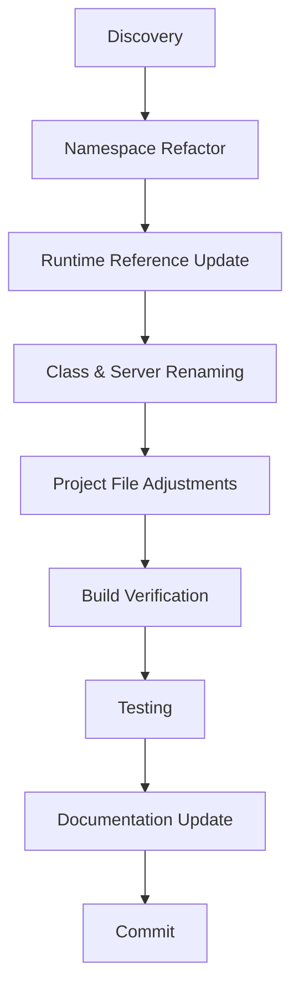

# Refactoring Plan for Name.Engine.Platform

## Objective
Replace all remnants of the legacy **PrimordialPower** namespace and runtime references in the **Name.Engine.Platform** project with the new **Name.Engine** namespace. Ensure that the code compiles, passes all existing tests, and follows proper C# naming and project conventions.

## Scope
- All source files under `src/Name.Engine.Platform/`
- Project files (`*.csproj`) within the same directory
- Any generated files that may contain hard‑coded namespace strings

## Steps
1. **Discovery**
   - Perform a recursive search for the token `PrimordialPower` in all `.cs` files.
   - Record each occurrence: file path, line number, and context (namespace declaration, using directive, type name, string literal).
2. **Namespace Refactor**
   - Replace `namespace PrimordialPower` (or any sub‑namespace) with `namespace Name.Engine`.
   - Update `using PrimordialPower.*` statements to `using Name.Engine.*`.
3. **Runtime Reference Update**
   - Change any `PrimordialPower.Runtime` references to `Name.Engine` (e.g., base classes, interfaces, attribute usages).
4. **Class & Server Renaming**
   - Identify classes whose names embed `PrimordialPower` (e.g., `PrimordialPowerServer`).
   - Rename them to the appropriate `Name.Engine` equivalents, updating all references.
5. **Project File Adjustments**
   - Open `src/Name.Engine.Platform/Name.Engine.Platform.csproj`.
   - Remove any `<Reference>` or `<PackageReference>` entries that point to a `PrimordialPower` assembly.
   - Ensure the project references `../Name.Engine/Name.Engine.csproj` (already present).
6. **Build Verification**
   - Run `dotnet build` in the solution root.
   - Resolve any compilation errors caused by the refactor (e.g., missing usings, ambiguous types).
7. **Testing**
   - Execute all unit tests: `dotnet test`.
   - Verify that no test failures are introduced.
8. **Documentation Update**
   - Search the repository for `PrimordialPower` in markdown files and update documentation accordingly.
9. **Commit**
   - Stage all changes and create a commit with a clear message, e.g., `refactor: replace PrimordialPower with Name.Engine`.

## Timeline (Logical Order)

## Risks & Mitigations
- **Missing References**: Some `PrimordialPower` strings may be embedded in generated code. Mitigation: Regenerate after refactor if needed.
- **Breaking API**: Changing public class names could affect downstream projects. Mitigation: Keep backward‑compatible type aliases temporarily.
- **Incomplete Search**: Binary resources may still contain the old namespace. Mitigation: Perform a full‑text search across the repo after changes.

## Acceptance Criteria
- No occurrences of the string `PrimordialPower` remain in any source or project file.
- The solution builds cleanly with `dotnet build`.
- All unit tests pass (`dotnet test`).
- Documentation no longer references the old namespace.
