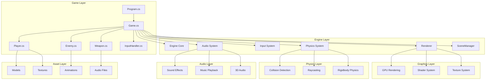
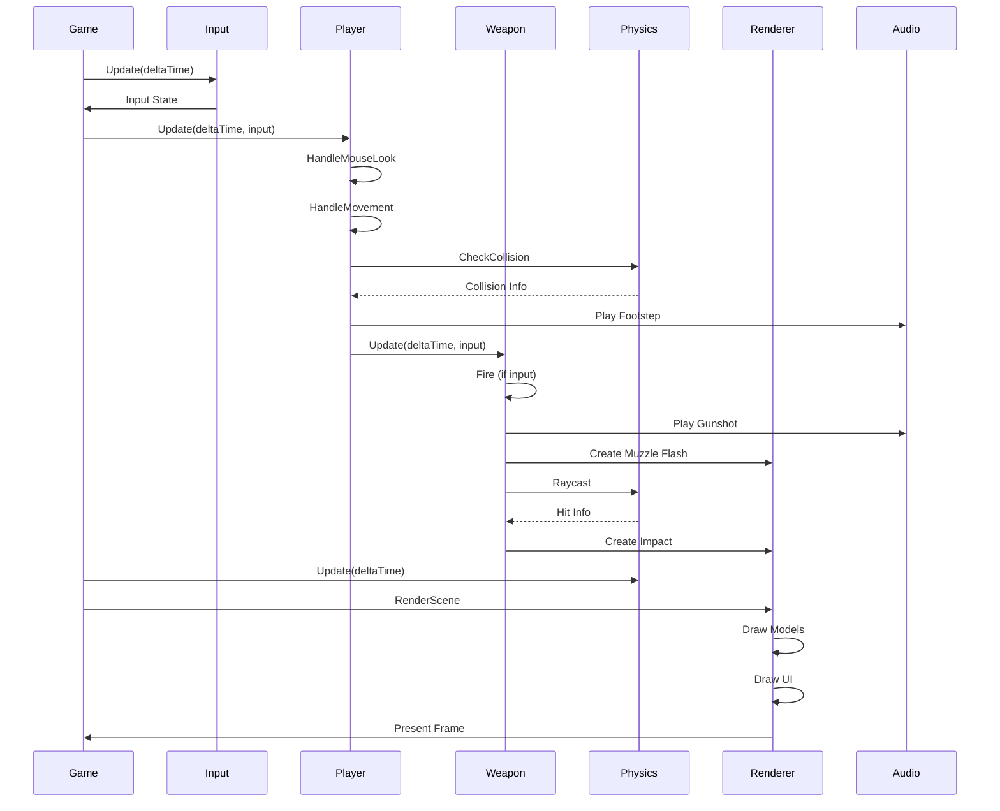

# Oblivion Game Engine Architecture

## High-Level Architecture



## Component Interactions



## Engine API Design

### Core Engine
- `GameBase`: Abstract base class for game implementation
- `EngineConfig`: Configuration for engine initialization
- `Game`: Static access to game instance

### Rendering
- `Renderer`: Main rendering interface
- `Camera`: Camera component with projection/view matrices
- `Transform`: Position, rotation, scale

### Input
- `InputSystem`: Low-level input handling
- `Key` and `MouseButton`: Input enums
- `InputHandler`: Game-specific input abstraction

### Physics
- `PhysicsSystem`: Physics simulation
- `CollisionInfo`: Collision detection results
- `RaycastHit`: Raycast results

### Audio
- `AudioSystem`: Audio management
- Sound effects and music playback
- 3D positional audio

## File Structure

```
Oblivion/
├── Program.cs              # Entry point
├── Game.cs                 # Main game class
├── InputHandler.cs         # Input abstraction
├── Entities/
│   ├── Entity.cs           # Base entity class
│   ├── Player.cs           # Player implementation
│   └── Enemy.cs            # Enemy implementation
├── Weapons/
│   └── Weapon.cs           # Weapon implementation
└── Architecture.md         # This file